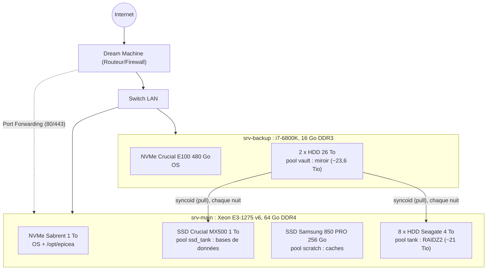
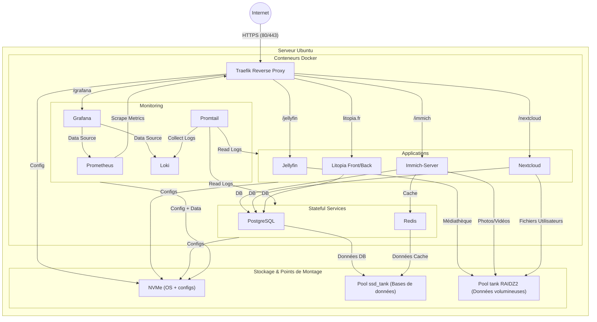

# EpiceaInfra - Mon Infrastructure Personnelle en tant que Code (IaC)

Ce dépôt contient l'ensemble de la configuration de mon infrastructure personnelle. L'objectif est de tout gérer de manière déclarative et automatisée, en minimisant les interventions manuelles.

## 🎯 Objectif & Philosophie

1.  **100 % IaC** : Tout est versionné dans Git. Pas de configuration manuelle "sauvage".
2.  **Réduction du SSH** : Les interventions se font par `git push`, pas par des connexions manuelles.
3.  **Fiabilité > Performance** : La stabilité et la facilité de maintenance sont prioritaires.

---

## 📊 Schémas d'Infrastructure

### Architecture Matérielle & Réseau

Le **Dream Machine** agit comme routeur/pare-feu. Deux serveurs Ubuntu bare-metal : **srv-main** héberge les services et toutes les données sur des disques locaux en ZFS, **srv-backup** tire chaque nuit une copie des snapshots ZFS.



| Pool | Disques | Topologie | Contenu | Sauvegardé |
|------|---------|-----------|---------|------------|
| `tank` (srv-main) | 8 x 4 To HDD | RAIDZ2 | Médias, photos, Nextcloud, copie de `/opt/epicea` | ✅ |
| `ssd_tank` (srv-main) | Crucial MX500 1 To | Disque seul | PostgreSQL, Redis | ✅ |
| `scratch` (srv-main) | Samsung 850 PRO 256 Go | Disque seul | Cache Jellyfin, modèles ML Immich | ❌ (reconstructible) |
| `vault` (srv-backup) | 2 x 26 To HDD | Miroir | Réplique de `tank` et `ssd_tank` | — |

### Architecture Applicative (Conteneurs Docker)

Ce schéma montre comment les services conteneurisés interagissent et où leurs données sont stockées sur le serveur.



---

## 🚀 Guide du Développeur

> 📖 **Nouveau sur le projet ?** Commencez par le [guide simplifié](docs/GUIDE.md) : déploiement, sauvegardes, ajout d'un service. Référence technique : [DOC_TECHNIQUE.md](DOC_TECHNIQUE.md).

Cette section explique comment utiliser ce dépôt pour tester et déployer l'infrastructure.

### 1. Prérequis

Assurez-vous d'avoir installé les outils suivants sur votre poste de travail :
*   [Ansible](https://docs.ansible.com/ansible/latest/installation_guide/intro_installation.html)
*   [Make](https://www.gnu.org/software/make/)
*   [Multipass](https://multipass.run/)

### 2. Workflow de Développement

Voici les étapes pour développer et tester des changements sur l'infrastructure :

Les changements se testent sur un **banc de simulation** : deux VMs Multipass qui reproduisent srv-main et srv-backup, avec des disques simulés sous les mêmes noms `/dev/disk/by-id` que les vrais (tailles réduites). Le déploiement applique la configuration de **production**, pas une variante de test. Détails dans [scripts/simulation/README.md](scripts/simulation/README.md).

1.  **Tout tester depuis zéro** (environ 15 minutes) :
    ```bash
    make sim-all
    ```
    Cette commande crée les VMs, déploie srv-main et srv-backup, puis lance les tests de bout en bout : stockage, services, Traefik, monitoring, réplication, panne de disque et redémarrage.

2.  **Itérer** : après une modification du code Ansible, redéployer puis relancer les tests :
    ```bash
    make sim-deploy
    ```
    ```bash
    make sim-test
    ```

3.  **Inspecter une VM** :
    ```bash
    multipass shell srv-main-sim
    ```

### 3. Commandes du `Makefile`

Le `Makefile` est le point d'entrée unique pour toutes les opérations.

| Commande                | Description                                                                                             |
| ----------------------- | ------------------------------------------------------------------------------------------------------- |
| **Simulation**          |                                                                                                         |
| `make sim-all`          | Crée le banc, déploie les deux serveurs et lance tous les tests.                                        |
| `make sim-up`           | Crée les VMs `srv-main-sim` / `srv-backup-sim` et simule leurs disques.                                 |
| `make sim-deploy`       | Déploie srv-main (configuration de production + surcharges de `inventory/group_vars/simulation.yml`).   |
| `make sim-deploy-backup`| Déploie srv-backup et la réplication.                                                                   |
| `make sim-test`         | Lance les tests de bout en bout (`scripts/simulation/test-sim.sh`).                                     |
| `make sim-status`       | Affiche les conteneurs et les pools ZFS des VMs.                                                        |
| `make sim-down`         | Détruit les VMs de simulation.                                                                          |
| **Production**          |                                                                                                         |
| `make init`             | Crée et chiffre un nouveau fichier `vault.yml` pour la production, s'il n'existe pas.                   |
| `make secrets`          | Ouvre le fichier `vault.yml` chiffré pour l'édition.                                                    |
| `make vault-encrypt`    | Chiffre `vault.yml` (sans effet s'il l'est déjà).                                                        |
| `make vault-decrypt`    | Déchiffre `vault.yml` et le laisse en clair : le rechiffrer ensuite.                                     |
| `make vault-view`       | Affiche les secrets sans déchiffrer le fichier.                                                          |
| `make deploy`           | **(Action critique)** Déploie la configuration sur srv-main (demande le mot de passe du vault).         |
| `make deploy-backup`    | Déploie srv-backup et autorise la réplication ZFS depuis srv-main.                                      |
| `ZFS_CREATE=1`          | À ajouter à `deploy` / `deploy-backup` au **premier** déploiement pour créer les pools (efface les disques). |
| **Validation**          |                                                                                                         |
| `make validate`         | Vérifie la syntaxe des playbooks Ansible.                                                               |

---

## 📜 Contexte de l'Évolution

*   **Point de Départ** : Serveur unique sous Proxmox avec stockage ZFS local. La gestion des VMs et du stockage était devenue trop complexe et rigide.
*   **Piste abandonnée** : Externaliser le stockage sur des NAS Ubiquiti en NFS, avec une carte graphique NVIDIA dédiée.
*   **Infrastructure définitive** : Un serveur **Ubuntu Bare-metal** (Xeon E3-1275 v6, 64 Go) qui porte lui-même ses disques en **ZFS** (RAIDZ2 sur 8 HDD, SSD dédiés aux bases et aux caches), sans carte graphique : le transcodage Jellyfin passe par **Quick Sync**, intégré au Xeon. Un second serveur Ubuntu (**srv-backup**, miroir 2 x 26 To) reçoit chaque nuit les snapshots ZFS par **syncoid**, en mode *pull*.
